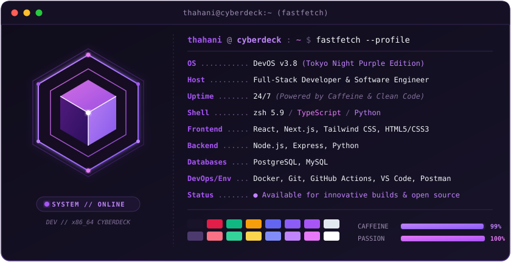

  <!-- ==================== HEADER BANNER ==================== -->
  

  <!-- Animated Typing SVG -->
  

  <!-- Location & Philosophy -->
  

    📍 <b>Sri Lanka</b> &nbsp; | &nbsp; ⚡ <i>Passionate about building scalable systems, fluid interfaces, and intuitive digital experiences.</i>
  

  <!-- Social & Connect Badges -->
  

    &nbsp;
    &nbsp;
    
  

---

<!-- ==================== HERO: CYBERPUNK TERMINAL ==================== -->

  ### 🖥️ System Telemetry & Environment

  

---

<!-- ==================== TECH STACK & ARSENAL ==================== -->

  ### 🛠️ Tech Stack & Arsenal

   

  
<b>Languages &amp; Frontend</b>

  

    

  
<b>Backend &amp; Databases</b>

  

    

  
<b>DevOps &amp; Developer Tools</b>

  

---

<!-- ==================== FOOTER WAVE ==================== -->

  

